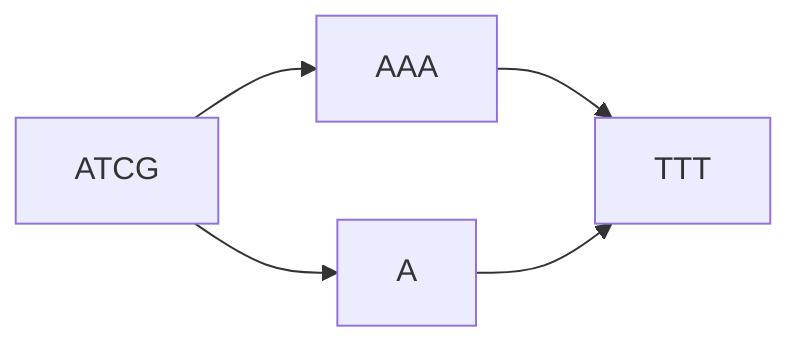
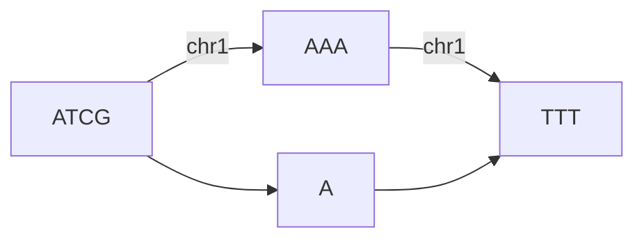
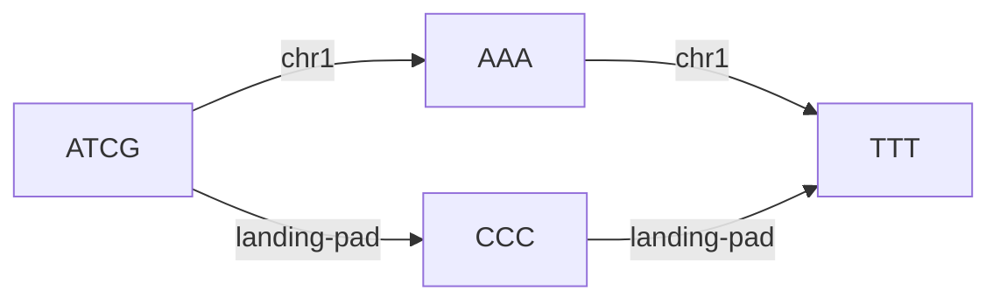
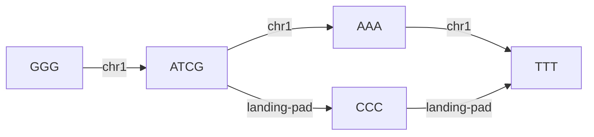

# Paths and Accessions

Graphs have particular challenges when it comes to referring to regions within one. For example, take the following
chromosome and a simple change to it:

If we specified an insertion at position 6, would it refer to `ATCGA_A_` or `ATCGA_T_`? Paths offer a mechanism
to provide a linear sequence through a graph. Paths are an ordered series of edges that provide a mechanism for 
addressing the space within a graph. For example, we could assign `Chr1` to the graph in the following manner:

and thus provide a reference frame for modifications. On fasta import, each header automatically becomes a defined path,
so `Chr1` and so on will be automatically assigned.

## Annotation coordinate sources

An annotation file is associated with a source sample and collection when it is added.
Each record's contig name (or reference alias) identifies a block group in that sample;
that block group's current path defines the record's coordinates. Paths do not carry
reference flags, and annotation translation does not search the destination's ancestors.

`gen add-annotation-file genes.gff3 --collection genome` uses the collection's reference
sample. Use `--sample SAMPLE` when the file describes a different sample. If several
reference samples exist, select one explicitly. The configured collection is used by
default; with no configured collection, a single existing collection is inferred.

Views and annotation searches first translate coordinates using the file's source sample,
then project the resulting node segments onto the graph being viewed. Descendant updates
therefore do not reinterpret an ancestor's annotation file using descendant coordinates.
The same file can be attached to multiple samples with separate coordinate associations.
Stored annotations continue to use node coordinates through accessions.

Source associations are versioned with the annotation operation. Historical views use the
source sample's paths at the selected revision. Older unassociated files fall back to the
reference sample of the sole collection. Ambiguous legacy sources must be reattached with
an explicit sample and collection. The source sample's current paths are assumed stable after association.

## Accessions

When inserting changes to a genome, we may want to refer to the modifications. For example, in the above change, we have
no way to refer to the `A` node. Accessions allow us to provide an addressable subspace within the graph. This is 
especially useful for a stable reference to a sub-sequence such as a gene of interest or a landing pad, as iterative 
changes to the genome may alter its relative position.  

To illustrate this, suppose we are inserting a small landing pad into a genome.

Now, suppose in a downstream sample we insert a sequence before the landing pad.

While chr1's length has changed, `landing-pad`'s coordinates have not. This permits operations to simply refer to 
`landing-pad` instead of knowing the chromosomal coordinates of the landing pad.
