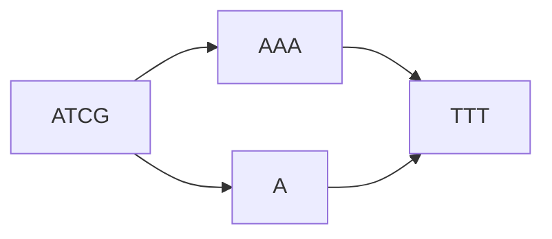
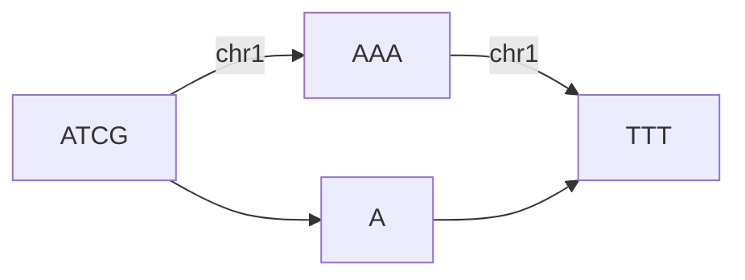
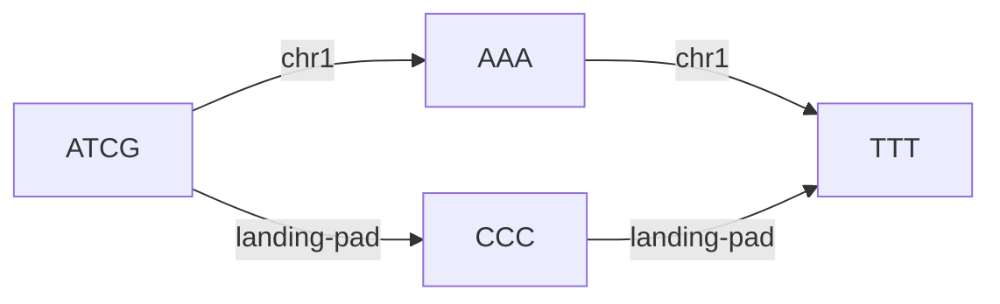
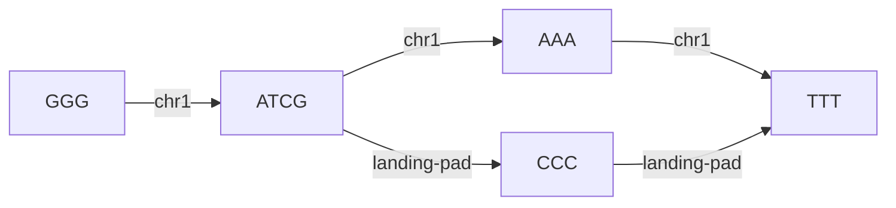

# Paths and Accessions

Graphs have particular challenges when it comes to referring to regions within one. For example, take the following
chromosome and a simple change to it:

If we specified an insertion at position 6, would it refer to `ATCGA_A_` or `ATCGA_T_`? Paths offer a mechanism
to provide a linear sequence through a graph. Paths are an ordered series of edges that provide a mechanism for 
addressing the space within a graph. For example, we could assign `Chr1` to the graph in the following manner:

and thus provide a reference frame for modifications. On fasta import, each header automatically becomes a defined path,
so `Chr1` and so on will be automatically assigned.

## Reference paths

Paths have an `is_reference` flag that identifies the coordinate reference for a block-group
lineage. `Path::create` and `Path::create_with_validated_edges` require an explicit
`is_reference` argument. Imports mark their reference paths `true`; copying and ordinary
editing use `false`, leaving the inherited reference unchanged. GFA imports choose the first
path, or the first walk when no paths exist, as the reference for their single block group.

`BlockGroup::get_reference_path` checks the block group itself, then walks its parent chain to
find the nearest ancestor with a reference path. It returns that ancestor's path, which may
belong to a different block group. Historical lookups use the requested revision for both
ancestry and paths. A lineage without a reference returns an error.

Creating a path with `is_reference = true` in a descendant overrides its inherited reference.
Each block group can have at most one reference path, and existing paths cannot be promoted
through the creation methods. The current path remains the most recently created path,
independently of reference status.

## Accessions

When inserting changes to a genome, we may want to refer to the modifications. For example, in the above change, we have
no way to refer to the `A` node. Accessions allow us to provide an addressable subspace within the graph. This is 
especially useful for a stable reference to a sub-sequence such as a gene of interest or a landing pad, as iterative 
changes to the genome may alter its relative position.  

To illustrate this, suppose we are inserting a small landing pad into a genome.

Now, suppose in a downstream sample we insert a sequence before the landing pad.

While chr1's length has changed, `landing-pad`'s coordinates have not. This permits operations to simply refer to 
`landing-pad` instead of knowing the chromosomal coordinates of the landing pad.
